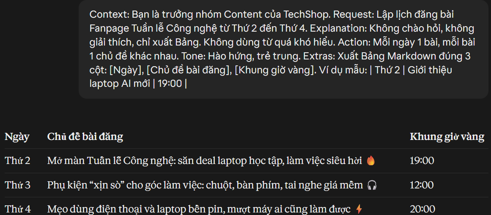

## Bước 1: Đề xuất 2 prompt mẫu

- **Giải pháp 1 (đơn giản):**

*Lập lịch đăng bài Fanpage TechShop cho Tuần lễ Công nghệ.*

- **Giải pháp 2 (chi tiết, có nhiều ràng buộc).**

*Context: Bạn là trưởng nhóm Content của TechShop.*
*Request: Lập lịch đăng bài Fanpage Tuần lễ Công nghệ từ Thứ 2 đến Thứ 4.*
*Explanation: Không chào hỏi, không giải thích, chỉ xuất Bảng. Không dùng từ quá khó hiểu.*
*Action: Mỗi ngày 1 bài, mỗi bài 1 chủ đề khác nhau.*
*Tone: Hào hứng, trẻ trung.*
*Extras: Xuất Bảng Markdown đúng 3 cột: [Ngày], [Chủ đề bài đăng], [Khung giờ vàng].*

*Ví dụ mẫu:*
*| Thứ 2 | Giới thiệu laptop AI mới | 19:00 |*

## Bước 2: Lập bảng so sánh Trade-off

| Tiêu chí | Giải pháp 1 (Đơn giản) | Giải pháp 2 (Chi tiết) |
|---|---|---|
| Độ dễ hiểu | Cao, ai cũng viết được | Trung bình, phải nhớ khung CREATE |
| Tốn token | Ít | Nhiều hơn |
| Thời gian viết | Vài giây | Vài phút |
| Chặn lỗi biên (AI trả dài dòng, sai cột, tự thêm ngày) | Trung bình, AI tự quyết hết | Cực tốt, có luật cấm và ví dụ mẫu |
| Kết quả đầu ra | Mỗi lần một kiểu | Luôn đúng 3 cột |
| Dán vào Excel | Phải sửa tay | Dán được ngay |

## Bước 3: Lựa chọn và chạy thử

- *Em sẽ chọn giải pháp 2 vì:*

Ra kết quả là xài được ngay, không phải sửa lại nhiều lần.
Có luật cấm và ví dụ mẫu nên AI ít làm sai.
Tốn thêm chút token và thời gian viết, nhưng tiết kiệm thời gian chỉnh sửa về sau.

